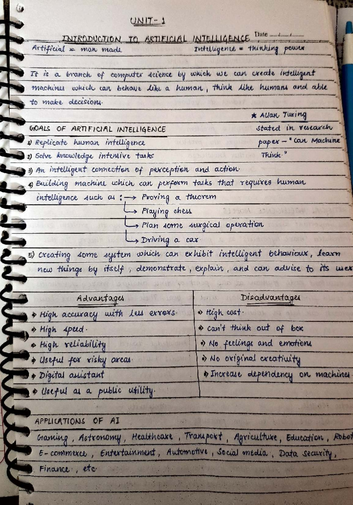
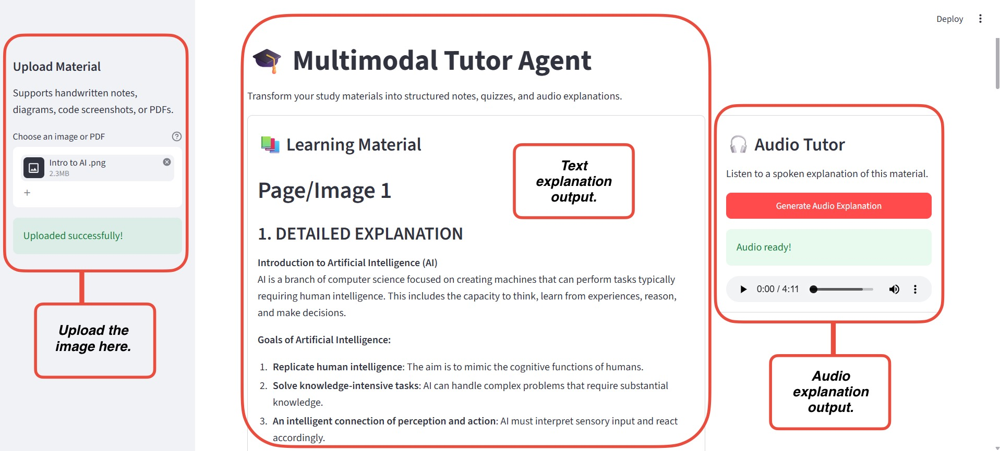

<div align="center">

# 🎓 Multimodal Tutor Agent

### Turn handwritten notes, diagrams & PDFs into structured study material and a spoken audio lesson


<a href="https://atharvwagh23.github.io/Multimodal_tutor_agentAI/player.html">
  
</a>

</div>

---

## ✨ What it does

Upload a photo of your notes, a diagram, a code screenshot, or a PDF. The agent reads it with a vision model and gives you:

| | Output |
|---|---|
| 📖 | Detailed explanation in simple language |
| 📝 | Quick revision notes |
| 💡 | Key concepts and why they matter |
| ❓ | 5 assignment questions with answers |
| 🌳 | Text-based mind map |
| 🎧 | A spoken audio explanation (MP3) |

---

## 🧪 Live Demo: Input → Output

### 1️⃣ Input: handwritten notes

<div align="center">
  
</div>

### 2️⃣ App Output: text + audio

<div align="center">
  
</div>

### 3️⃣ 🎧 Audio Output

<div align="center">

<a href="https://atharvwagh23.github.io/Multimodal_tutor_agentAI/player.html">
  
</a>

*Opens a player page where you can play, pause, and seek the AI-generated explanation.*

</div>

### 4️⃣ 📚 Text Output

<details>
<summary><b>Click to expand the generated learning material</b></summary>

<br>

#### 1. Detailed Explanation
**Introduction to Artificial Intelligence (AI)**

AI is a branch of computer science focused on creating machines that can perform tasks typically requiring human intelligence, including thinking, learning from experience, reasoning, and making decisions.

**Goals of AI**
1. Replicate human intelligence
2. Solve knowledge-intensive tasks
3. An intelligent connection of perception and action
4. Build machines for human-like tasks (proving a theorem, playing chess, planning surgical operations, driving a car)
5. Create systems that exhibit intelligent behavior: learn, demonstrate, and advise autonomously

| ✅ Advantages | ⚠️ Disadvantages |
|---|---|
| High accuracy with fewer errors | High cost |
| High speed | Lack of creativity |
| High reliability | Lack of emotions |
| Useful in risky areas | Increased dependency on machines |
| Digital assistant | |
| Public utility | |

**Applications:** Gaming, Astronomy, Healthcare, Transport, Agriculture, Education, Robotics, E-commerce, Entertainment, Automotive, Social media, Data security.

#### 2. Summary Notes
- **Definition:** study of creating intelligent machines that mimic human thinking
- **Goals:** replicate human intelligence, solve complex tasks, connect perception with action
- **Advantages:** accuracy, speed, reliability, utility in risky areas, digital assistance
- **Disadvantages:** high cost, no creativity or emotions, dependency on technology
- **Applications:** broad, from gaming to healthcare

#### 3. Important Concepts
- **Artificial Intelligence:** transformative potential across sectors
- **Human-like tasks:** show both AI's capabilities and limits
- **Advantages and disadvantages:** help assess practicality and ethics
- **Applications:** prepare students for future careers

#### 4. Assignment Questions
1. What is AI and why is it significant today?
2. List three goals of AI and explain one in detail.
3. Identify two advantages and two disadvantages of AI.
4. Describe an example of AI in healthcare.
5. Discuss the risks of becoming overly dependent on AI.

**Answers**
1. AI is a field of computer science that creates machines able to perform tasks requiring human intelligence; it improves efficiency and innovation.
2. Goals include replicating human intelligence, solving complex tasks, connecting perception and action.
3. Advantages: high accuracy, high speed. Disadvantages: high cost, lack of creativity.
4. AI can help diagnose diseases by analyzing medical data quickly and accurately.
5. Risks include loss of essential skills, job displacement, and ethical concerns over decision-making.

#### 5. Text-Based Mind Map
```
Artificial Intelligence
├── Definition
│   └── Man-made intelligence
├── Goals
│   ├── Replicate human intelligence
│   ├── Solve complex tasks
│   ├── Connection of perception and action
│   ├── Human-like task performance
│   └── Intelligent behavior systems
├── Advantages
│   ├── High accuracy
│   ├── High speed
│   ├── High reliability
│   ├── Risky area usage
│   ├── Digital assistance
│   └── Public utility
├── Disadvantages
│   ├── High cost
│   ├── Lack of creativity
│   ├── No emotions
│   └── Dependency on machines
└── Applications
    ├── Gaming
    ├── Healthcare
    ├── Automotive
    └── Others
```

#### 6. Uncertainties
- Some handwritten text is slightly hard to read.
- The exact phrasing of some points may be unclear due to handwriting style.

</details>

---

## 🏗️ How it works

```
 Upload (image / PDF)
        │
        ▼
 PDF → PNG pages (pdf2image)            only for PDFs
        │
        ▼
 Image → OpenAI vision model → structured tutor notes
        │
        ▼
 Notes → OpenAI text-to-speech → MP3 audio
        │
        ▼
 Everything traced in LangSmith
```

---

## 📁 Project structure

```
Multimodal_tutor_agentAI/
├── app.py                 # Streamlit UI
├── main.py                # CLI smoke test
├── player.html            # Audio player page for the README demo
├── utils/
│   ├── config.py          # Env vars and folder setup
│   ├── openai_utils.py    # Vision analysis and tutor prompt
│   ├── audio_utils.py     # Text-to-speech
│   ├── pdf_utils.py       # PDF to images
│   ├── ocr_utils.py       # Optional Tesseract OCR
│   └── tracing_utils.py   # OpenAI client and LangSmith tracing
├── audio/                 # Generated MP3 files
├── photos_Readme/         # README screenshots
└── pyproject.toml
```

---

## ⚙️ Setup

**Prerequisites:** Python 3.12+, [uv](https://docs.astral.sh/uv/), Poppler (for PDF support), and an OpenAI API key.

```bash
# 1. Clone the repo
git clone https://github.com/atharvwagh23/Multimodal_tutor_agentAI.git
cd Multimodal_tutor_agentAI

# 2. Install dependencies
uv sync

# 3. Add your keys
cp _.env_example .env

# 4. Run the app
uv run streamlit run app.py
```

**`.env` settings**

```env
OPENAI_API_KEY=your_openai_api_key_here
OPENAI_VISION_MODEL="gpt-4o-mini"
OPENAI_TTS_MODEL="gpt-4o-mini-tts"
OPENAI_TTS_VOICE="coral"
LANGSMITH_TRACING="True"
LANGSMITH_API_KEY=your_langsmith_api_key_here
```

**CLI test (no UI)**
```bash
uv run python main.py path/to/image.png
```

---

## 🧰 Tech stack

| Layer | Tool |
|---|---|
| UI | Streamlit |
| Vision and text | OpenAI `gpt-4o-mini` |
| Text-to-speech | OpenAI `gpt-4o-mini-tts` (voice: coral) |
| PDF conversion | pdf2image |
| OCR (optional) | pytesseract |
| Tracing | LangSmith |
| Packages | uv |

---

## 👤 Author

**Atharv Wagh** · [GitHub](https://github.com/atharvwagh23)


